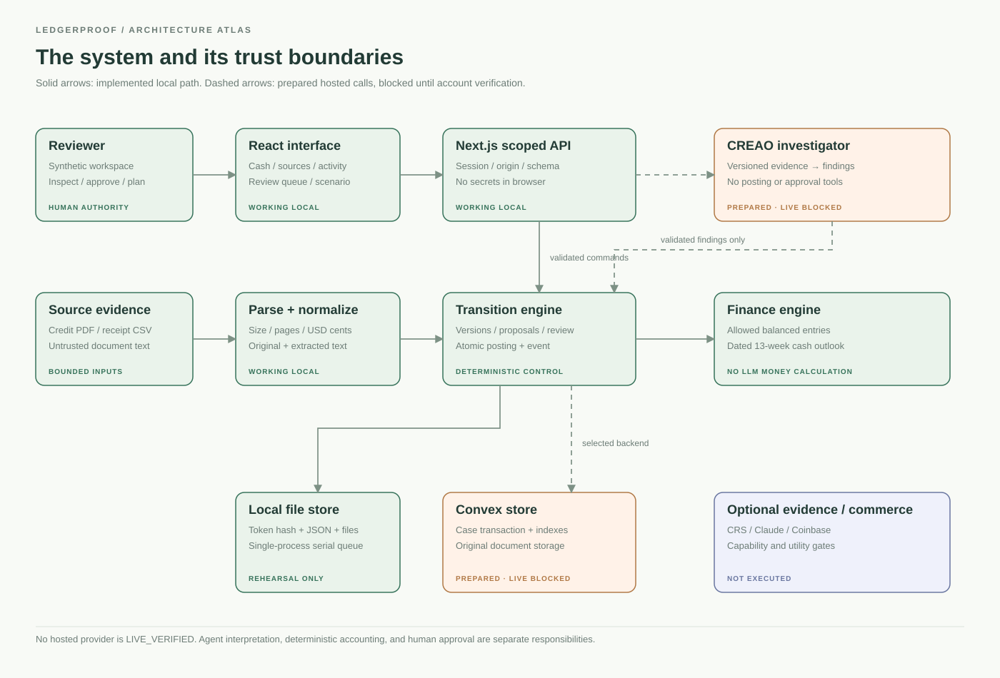
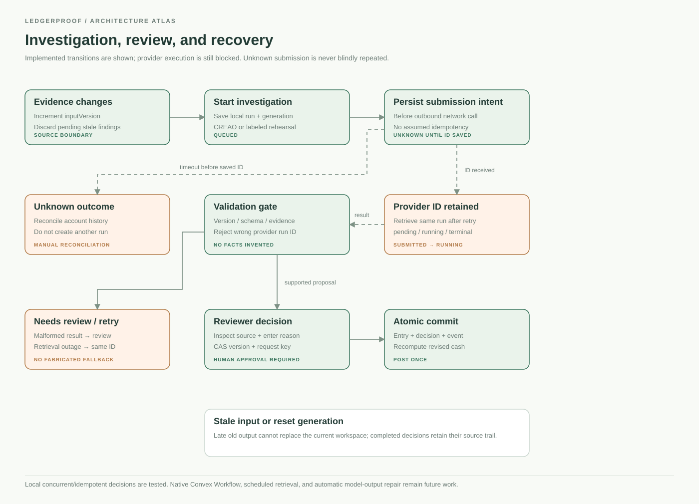
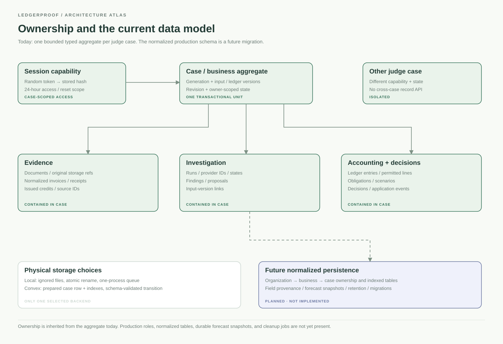
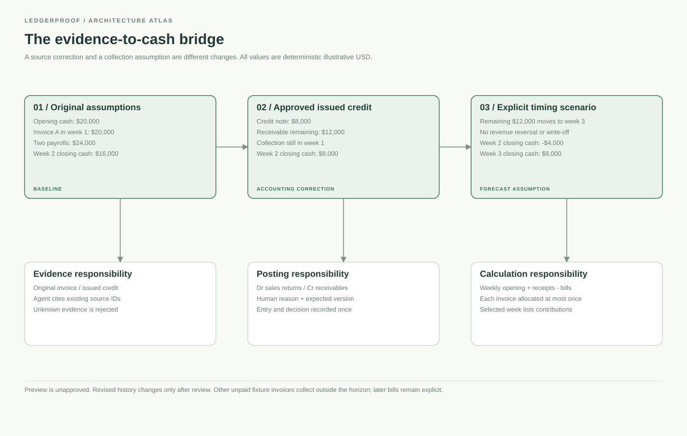
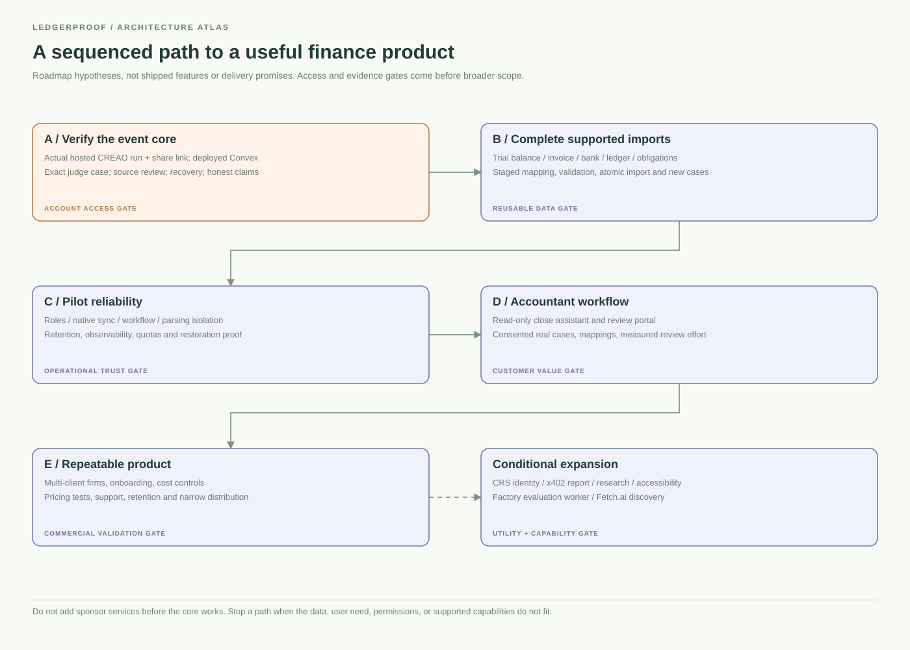

# Architecture atlas

Each diagram has an editable Mermaid source, portable SVG and exported PNG under diagrams/. Regenerate SVG with `python3 scripts/render-diagrams.py`; regenerate briefing/PDF/PNG using the npm docs scripts. Green denotes a working local component, orange a prepared but blocked hosted path, and blue a future/conditional path. A box is not evidence of a live integration.

## 1. System context and trust boundaries

The browser handles presentation and review; the server handles scoped access and secrets. Documents are untrusted inputs. CREAO is intended to interpret evidence, while the deterministic transition and finance modules enforce posting and amounts. Local storage is tested; Convex/CREAO hosted paths are prepared but not verified. [Editable source](diagrams/01-system-context.mmd).

## 2. Investigation, review and recovery

A saved provider ID is the recovery anchor. An ambiguous submission is not blindly repeated. Output must pass source/version checks before a supported proposal reaches the reviewer. Human approval is distinct from agent findings. Stale input and reset generations protect current state. [Editable source](diagrams/02-workflow-recovery.mmd).

## 3. Ownership and physical model

All current entities inherit one case's ownership in a bounded aggregate. Local file serialization and future Convex transactions are distinct implementations of the store interface. Production organization roles, normalized tables and persistent forecast snapshots remain future work. [Editable source](diagrams/03-data-ownership.mmd).

## 4. Evidence-to-cash calculation

The $8,000 credit is a reviewed accounting correction; moving collection to week 3 is a timing assumption. Neither change is a default probability or automatic write-off. The UI lets judges inspect contributions rather than trust a fixed reveal. [Editable source](diagrams/04-cash-bridge.mmd).

## 5. Development gates

Verify the mandatory live core before expanding import breadth, reliability, accountant workflows, or conditional services. Phase estimates and acceptance criteria are in FUTURE-DEVELOPMENT.md. [Editable source](diagrams/05-development-roadmap.mmd).
